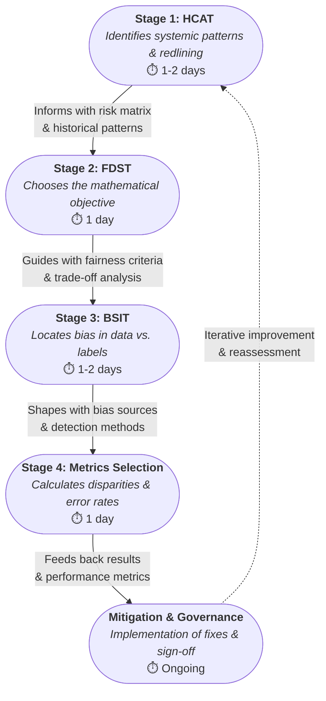

# AI Fairness Audit Playbook (v1.0)

**Owner:** AI Governance Team
**Target Audience:** Engineering Leads, Data Scientists, PMs
**Last Updated:** January 2026

## 1. Vision & Purpose
This Playbook establishes a centralized, standardized framework for evaluating and mitigating bias across an organization's AI portfolio. By integrating qualitative historical research (HCAT — Historical Context Assessment Tool) with quantitative validation, teams can produce defensible, auditable fairness assessments.

### Strategic Value Proposition
🛡️ **Risk Mitigation & Compliance**
- **Regulatory Readiness**: Aligns AI development with emerging global standards (e.g., EU AI Act, NIST AI RMF), reducing legal and compliance risk.
- **Proactive Defense**: Identifies potential discriminatory patterns before deployment, significantly reducing liability and remediation costs.
- **Brand Protection**: Preserves institutional trust by preventing algorithmic bias incidents that lead to public scrutiny.

🚀 **Operational Excellence**
- **Standardized Auditing**: Replaces ad-hoc reviews with a repeatable process to ensure consistent quality across models and teams.
- **Efficiency at Scale**: Uses a Tiered Audit approach to provide lightweight automated checks for low-risk systems while directing expert resources to high-impact models.
- **Accelerated Time-to-Market**: Clear pass/fail criteria reduce ambiguity in compliance reviews and speed deployment where appropriate.

### The ROI Framework
The playbook balances depth with speed to maximize return on governance by catching the majority of statistical disparities through automated Tier 1 checks while reserving deeper analyses for higher-risk systems.

## 2. Integrated Workflow
The Playbook operates as a four-stage pipeline where each component informs the next:
HCAT (Historical Context Assessment) → FDST (Fairness Definition Selection) → BSIT (Bias Source Identification) → Fairness Metrics & Validation

## 3. Implementation Guidelines
### Organizational Integration
* **Time Requirement:** Initial audit: 3–5 days; Retraining audits: 1 day.
* **Expertise:** Designed for L3+ Engineers. Staff Fairness Engineer consultation required for "Red Zone" disparities (>15%).
* **Tooling:** Integrate with existing CI/CD via Python (Fairlearn/AIF360) and documentation using model cards.

### Tiered Implementation Approach
**Tier 1 (Essential - 4 hours)**: Lightweight assessment for all projects
- Basic fairness checklist integration
- Automated risk scoring
- Self-service documentation

**Tier 2 (Standard - 1–2 days)**: Comprehensive audit for medium-risk domains
- Full component execution
- Cross-functional stakeholder involvement
- Detailed mitigation planning

**Tier 3 (Advanced - 3–5 days)**: Complete framework for high-risk/regulatory domains
- Full historical context analysis
- Advanced bias detection
- Regulatory compliance validation

### Domain Adaptability
* **Healthcare:** Focus on clinical measurement bias and equal opportunity.
* **Finance:** Focus on regulatory compliance and demographic parity.
* **Classification:** Use confusion matrix parity.
* **Regression:** Use bounded group loss or R-squared disparity.

## 4. Glossary
Definitions are provided for key terms (AI Fairness Audit Playbook, BSIT, HCAT, FDST, bounded group loss, etc.) to ensure clarity across teams.

---
