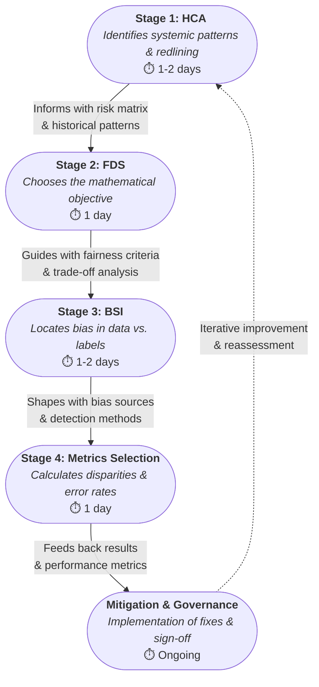

# AI Fairness Audit Playbook (v1.0)  

**Owner:** Staff Engineer / AI Governance
**Target Audience:** Engineering Leads, Data Scientists, PMs  
**Last Updated:** January 2026  

## 1. Vision & Purpose
This Playbook establishes a centralized, standardized framework for evaluating and mitigating bias across an organization's AI portfolio. By integrating qualitative historical research (HCAT) with rigorous quantitative measurement (Fairness Metrics Tool), it transforms fairness from a subjective ethical concern into a scalable, accountable engineering standard.

### Strategic Value Proposition
🛡️ **Risk Mitigation & Compliance**
- **Regulatory Readiness**: Aligns AI development with emerging global standards (e.g., EU AI Act, NIST AI RMF), shielding the organization from tiered non-compliance penalties.
- **Proactive Defense**: Identifies potential discriminatory patterns before deployment, significantly reducing legal liability and the cost of post-launch remediation.
- **Brand Protection**: Preserves institutional trust by preventing "algorithmic bias" incidents that lead to public scrutiny and brand erosion.

🚀 **Operational Excellence**
- **Standardized Auditing**: Replaces ad-hoc, inconsistent reviews with a repeatable process, ensuring every model—regardless of department—is held to the same high standard.
- **Efficiency at Scale**: Utilizes a "Tiered Audit" approach, allowing for rapid automated checks on low-risk systems while focusing expert resources on high-impact models.
- **Accelerated Time-to-Market**: Clear "Pass/Fail" criteria reduce the ambiguity of compliance reviews, allowing for faster, more confident deployment cycles.

### The ROI Framework
The playbook is designed to maximize Return on Governance (ROG) by balancing depth with speed by catching the majority of statistical disparities through automated Tier 1 checks, the organization can mitigate the bulk of its fairness-related risk at a fraction of the cost of a full-scale manual audit.

## 2. Integrated Workflow
The Playbook operates as a four-stage pipeline where each component informs the next:
[**Historical Context Assessment (HCA)**](/components/historical-context-assessment.md) → Informs the  [**Fairness Definition Selection (FDS)**](/components/fairness-definition-selection.md) → Guides the [**Bias Source Identification (BSI)**](/components/bias-source-identification.md) → Shapes the [**Metrics Selection**](/components/fairness-metrics.md).

## 3. Implementation Guidelines
### Organizational Integration
* **Time Requirement:** Initial audit: 3-5 days; Retraining audits: 1 day.
* **Expertise:** Designed for L3+ Engineers. Staff Fairness Engineer consultation required only for "Red Zone" disparities (>15%).
* **Tooling:** Integrate with existing CI/CD via Python (Fairlearn/AIF360) and Documentation (Model Cards).

### Tiered Implementation Approach
**Tier 1 (Essential - 4 hours)**: Lightweight assessment for all projects
- Basic fairness checklist integration
- Automated risk scoring
- Self-service documentation

**Tier 2 (Standard - 1-2 days)**: Comprehensive audit for medium-risk domains
- Full component execution
- Cross-functional stakeholder involvement
- Detailed mitigation planning

**Tier 3 (Advanced - 3-5 days)**: Complete framework for high-risk/regulatory domains
- Full historical context analysis
- Advanced bias detection
- Regulatory compliance validation

### Domain Adaptability
* **Healthcare:** Focus on *Clinical Measurement Bias* and *Equal Opportunity*.
* **Finance:** Focus on *Regulatory Compliance* and *Demographic Parity*.
* **Classification:** Use *Confusion Matrix Parity*.
* **Regression:** Use *Bounded Group Loss* or *R-Squared Disparity*.

## 4. Glossary

**AI Fairness Audit Playbook**: A standardized framework for evaluating bias in AI systems through four integrated stages: Historical Context Assessment, Fairness Definition Selection, Bias Source Identification, and Metrics Selection.

**Bias Source Identification Tool (BSIT)**: Component 3 of the playbook that categorizes and detects different types of bias (historical, representation, measurement, aggregation, learning, evaluation, deployment) within AI systems.

**Bounded Group Loss**: A fairness definition for regression problems that ensures prediction errors for any protected group remain within acceptable bounds compared to the overall population.

**Clinical Measurement Bias**: Systematic errors in medical data collection or measurement that disproportionately affect certain demographic groups, potentially leading to biased AI diagnostic models.

**Confusion Matrix Parity**: A fairness approach ensuring that error rates (false positives, false negatives) are balanced across protected groups in classification tasks.

**Demographic Parity**: A fairness definition requiring that the probability of receiving a positive outcome is equal across all protected groups, regardless of underlying qualifications.

**Equal Opportunity**: A fairness definition ensuring that qualified individuals from all protected groups have the same probability of receiving a positive prediction.

**Fairness Definition Selection Tool (FDST)**: Component 2 of the playbook that helps teams choose appropriate mathematical fairness objectives (Demographic Parity, Equal Opportunity, etc.) based on historical context and project requirements.

**Fairness Debt**: The accumulation of bias in AI systems when development prioritizes technical efficiency over addressing historical and systemic inequities, similar to technical debt.

**Historical Context Assessment Tool (HCAT)**: Component 1 of the playbook that identifies domain-specific patterns of discrimination and translates them into technical risk assessments.

**Proxy Variables**: Features in a dataset that indirectly correlate with protected attributes (e.g., Zip code as a proxy for race), potentially introducing bias when used in AI models.

**R-Squared Disparity**: A fairness metric for regression problems measuring differences in model explanatory power across protected groups.

**Redlining**: A historical practice of denying services (loans, insurance) to neighborhoods based on racial composition, often used as an example of systemic bias that can manifest in AI systems.

**Regulatory Compliance**: Adherence to legal and regulatory requirements for fairness in AI systems, particularly in regulated industries like finance and healthcare.

---