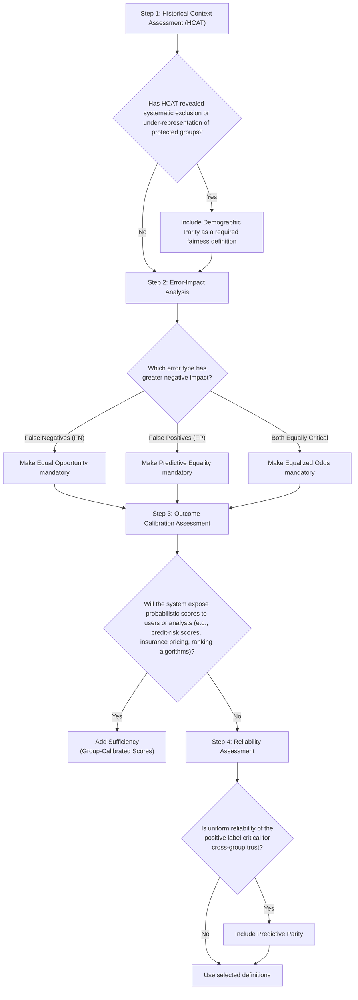

# Fairness Audit Playbook – Component 2
# Fairness Definition Selection Tool (FDST)

- [Fairness Audit Playbook – Component 2](#fairness-audit-playbook--component-2)
- [Fairness Definition Selection Tool (FDST)](#fairness-definition-selection-tool-fdst)
  - [1. Purpose](#1-purpose)
    - [Primary Goal](#primary-goal)
    - [FDS team](#fds-team)
    - [Inputs](#inputs)
    - [Outputs](#outputs)
    - [Implementation](#implementation)
  - [2. Fairness Definition Catalog](#2-fairness-definition-catalog)
  - [3. Definition Selection Decision Tree](#3-definition-selection-decision-tree)
  - [4. Trade-Off Analysis](#4-trade-off-analysis)
  - [5. Operational Guidelines](#5-operational-guidelines)

## 1. Purpose
- [ ]  Translating abstract fairness concepts into practical selection methodologies for engineering teams.
- [ ]  Mapping application contexts to appropriate fairness definitions.
- [ ]  Creating structured approaches for navigating inherent tensions between competing fairness criteria.
- [ ]  Balancing theoretical rigor with practical usability in business environments.
  
### Primary Goal

Select and justify a primary mathematical fairness metric for model auditing.

### FDS team	

Lead Data Scientists, Legal/Compliance, Product Owners, and DEI Leads.

### Inputs	
[HCAT](/components/historical-context-assessment.md) Risk Matrix (Comp. 1), Model Objective Functions, and Label Reliability reports.
### Outputs	
Primary Metric Selection, Disparity Thresholds (e.g., 80% Rule), and Trade-off Memos.
### Implementation	
To be completed during the Technical Scoping Phase before model training.

---

## 2. Fairness Definition Catalog
   
**Demographic Parity (Statistical Parity)**
- **Definition**: The probability of receiving a positive outcome must be identical across all protected groups, regardless of qualification rates.
- **Mathematical form**: P(Ŷ=1|A=a) = P(Ŷ=1|A=b) for all protected groups a, b.
- **When to Use**: When equal representation is the primary goal, particularly in domains with historical exclusion or where base rates reflect structural disadvantages.
- **Limitations**: Can reduce overall accuracy when base rates differ legitimately; may create reverse discrimination; does not ensure individual fairness.
- **Example**: A university outreach algorithm that displays STEM career advertisements to different gender groups at equal rates to counteract historical underrepresentation.

**Equal Opportunity**
- **Definition**: Qualified individuals must have the same probability of receiving a positive prediction across all protected groups.
- **Limitations**: Does not address false positive disparities; depends on trustworthy labels that may themselves contain historical bias.
- **Mathematical form**: P(Ŷ=1|Y=1,A=a) = P(Ŷ=1|Y=1,A=b) for all protected groups a, b.
- **Example**: A medical screening tool ensuring that patients with a particular condition have the same probability of being correctly identified regardless of race or socioeconomic status.
- **When to Use**: When false negatives (missing qualified candidates) are more concerning than false positives, and when ground truth labels are reliable.

**Equalized Odds**
- **Mathematical form**: P(Ŷ=1|Y=y,A=a) = P(Ŷ=1|Y=y,A=b) for y ∈ {0,1} and all protected groups a, b.
- **When to Use**: When both error types (false positives and false negatives) have significant impacts and must be balanced across groups.
- **Limitations**: Often creates more significant trade-offs with accuracy; typically requires more complex implementation approaches.
- **Definition**: Both true positive and false positive rates must be equal across all protected groups.
- **Example**: A recidivism prediction system where both wrongly detaining non-recidivating individuals and mistakenly releasing recidivating individuals have serious consequences that must be equitably distributed.

**Predictive Parity** 
- **Definition**: Ensures that predictions have consistent meaning across groups
- **Mathematical form**: P(Y = 1 | Ŷ = 1, A = a) = P(Y = 1 | Ŷ = 1, A = b).
- **When to Use**: To ensure that a model's positive outcomes have uniform reliability and precision across different demographics, particularly in high-stakes decisions where trust and consistent meaning are essential.
- **Limitations**: Ignores individuals missed by positive predictions, can be mathematically impossible to achieve when group base rates differ, and risks masking historical biases embedded in the ground truth data.
- **Example**: To satisfy Predictive Parity, the probability that a hotel actually receives zero complaints given that the AI predicted zero complaints must be equal for hotels in Paris $(A=a)$ and hotels in Nairobi $(A=b)$.

Remember that fairness definition selection is not merely a technical choice but reflects fundamental philosophical and ethical principles about what constitutes fair treatment in your specific context.

---

## 3. Definition Selection Decision Tree

---

## 4. Trade-Off Analysis

**Selected Definition Documentation**
State the definition chosen based on the Decision Tree and the specific context.

**Primary Fairness Definition Selected**:
- [ ] Demographic Parity (Statistical Parity) - P(Ŷ=1|A=a) = P(Ŷ=1|A=b) for all protected groups a, b.
- [ ] Equal Opportunity - P(Ŷ=1|Y=1,A=a) = P(Ŷ=1|Y=1,A=b) for all protected groups a, b.
- [ ] Equalized Odds - P(Ŷ=1|Y=y,A=a) = P(Ŷ=1|Y=y,A=b) for y ∈ {0,1} and all protected groups a, b.
- [ ] Predictive Parity - P(Y = 1 | Ŷ = 1, A = a) = P(Y = 1 | Ŷ = 1, A = b).

**Selection Rationale**:
  - Connection to historical context
  - Application requirements 
  - Stakeholder priorities
  
**Trade-off Acknowledgment**:
- Fairness Properties Not Satisfied: Explicitly list mathematically incompatible definitions (e.g., if you selected Equalized Odds, acknowledge that Predictive Parity may not hold). Mentioning impossibility theorems (e.g., Chouldechova, Kleinberg et al.) provides rigor for why these trade-offs are fundamental.
- Performance implications: *Quantify how prioritizing fairness affects traditional metrics like accuracy or precision. Frame trade-offs in terms of business risks and values.*
- Monitoring approach: *Monitoring strategy for satisfied and unsatisfied metrics. Describe how the primary definition will be tracked and validated, and how unsatisfied metrics (like Demographic Parity) will be monitored as secondary indicators to detect unintended consequences.*

---

## 5. Operational Guidelines
The FDST follows a phased process integrated with rigorous engineering standards to ensure the final metric is defensible, robust, and socially grounded.

- Step 1: Ingest & Contextualize (HCAT)
  - Action: Pull mandatory baselines from the Historical Context Assessment Tool.
  - Standard: Use the HCAT Risk Classification Matrix to identify mandatory fairness baselines. Ensure technical constraints address documented systemic harms (e.g., historical redlining) rather than relying solely on generic legal requirements.
- Step 2: Analysis & Scoping
  - Action: Determine the Error-Impact Profile (False Negatives vs. False Positives).
  - Standard (Intersectional Analysis): Do not rely on single-attribute analysis. Audit protocols must examine intersections of attributes (e.g., Black women, older veterans) to ensure disparities are not masked by aggregate group data.
  - Standard (Individual Fairness): If the use case requires Individual Fairness, teams must define a similarity metric that captures relevant features while remaining blind to protected attributes.
- Step 3: Logic-Based Selection
  - Action: Traverse the Definition Selection Decision Tree to identify the mathematically appropriate primary metric.
  - Standard: Selection must be justified by the specific "History of Harm" identified in Step 1 (e.g., selecting Equal Opportunity when historical data deserts are present).
- Step 4: Reconciliation & Communication
  - Action: Document mathematical incompatibilities and business risks.
  - Standard: Frame trade-offs in terms of business values and stakeholder impact rather than pure mathematical definitions. Use concrete visualizations to illustrate how choosing one metric (e.g., Equalized Odds) may naturally degrade another (e.g., Predictive Parity).
- Step 5: Governance & Iteration
  - Action: Establish a "Fairness Monitoring" cadence.
  - Standard: Recognize that selection is not a one-time event. Reassess trade-offs quarterly as data distributions shift, legal requirements evolve, and societal norms change. 
  - Note: This component addresses Article 10 of the EU AI Act regarding data governance and bias monitoring, ensuring that the model's performance is not only accurate but legally defensible.