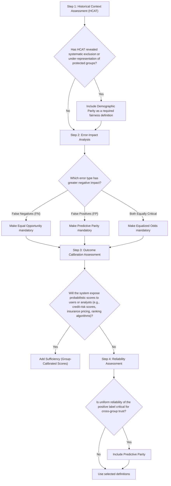

# Fairness Audit Playbook – Component 2
# Fairness Definition Selection Tool (FDST)

- [Fairness Audit Playbook – Component 2](#fairness-audit-playbook--component-2)
- [Fairness Definition Selection Tool (FDST)](#fairness-definition-selection-tool-fdst)
  - [1. Purpose](#1-purpose)
    - [Primary Goal](#primary-goal)
    - [FDS team](#fds-team)
    - [Inputs](#inputs)
    - [Outputs](#outputs)
    - [Implementation](#implementation)
  - [2. Fairness Definition Catalog](#2-fairness-definition-catalog)
  - [3. Definition Selection Decision Tree](#3-definition-selection-decision-tree)
  - [4. Trade-Off Analysis](#4-trade-off-analysis)
  - [5. Operational Guidelines](#5-operational-guidelines)

## 1. Purpose
- Translate abstract fairness concepts into practical selection methodologies for engineering teams.
- Map application contexts to appropriate fairness definitions.
- Create structured approaches for navigating tensions between competing fairness criteria.
- Balance theoretical rigor with practical usability in business environments.

### Primary Goal
Select and justify a primary mathematical fairness metric for model auditing.

### FDS team
Lead Data Scientists, Legal/Compliance, Product Owners, and DEI Leads.

### Inputs
HCAT Risk Matrix (Component 1), model objective functions, and label reliability reports.
### Outputs
Primary metric selection, disparity thresholds (e.g., 80% rule), and trade-off memos.
### Implementation
To be completed during the technical scoping phase before model training.

---

## 2. Fairness Definition Catalog

**Demographic Parity (Statistical Parity)**
- **Definition**: The probability of receiving a positive outcome must be identical across protected groups.
- **Mathematical form**: P(Ŷ=1|A=a) = P(Ŷ=1|A=b) for all protected groups a, b.
- **When to Use**: When equal representation is the primary goal, particularly in domains with historical exclusion.
- **Limitations**: Can reduce overall accuracy when base rates legitimately differ; does not ensure individual fairness.

**Equal Opportunity**
- **Definition**: Qualified individuals must have the same probability of receiving a positive prediction across protected groups.
- **Mathematical form**: P(Ŷ=1|Y=1,A=a) = P(Ŷ=1|Y=1,A=b) for all protected groups a, b.
- **When to Use**: When false negatives are more concerning and labels are reliable.
- **Limitations**: Does not address false positive disparities; depends on trustworthy labels.

**Equalized Odds**
- **Definition**: Both true positive and false positive rates must be equal across protected groups.
- **Mathematical form**: P(Ŷ=1|Y=y,A=a) = P(Ŷ=1|Y=y,A=b) for y ∈ {0,1} and all protected groups a, b.
- **When to Use**: When both error types have significant impacts and must be balanced across groups.
- **Limitations**: Often creates stronger trade-offs with accuracy; typically requires complex implementation.

**Predictive Parity**
- **Definition**: Ensures that predictions have consistent meaning across groups.
- **Mathematical form**: P(Y=1|Ŷ=1,A=a) = P(Y=1|Ŷ=1,A=b).
- **When to Use**: To ensure a model's positive outcomes have uniform reliability across demographics.
- **Limitations**: Can be impossible to satisfy jointly with other definitions when base rates differ.

Fairness definition selection is not merely a technical choice but reflects philosophical and ethical principles about fair treatment in your context.

---

## 3. Definition Selection Decision Tree

---

## 4. Trade-Off Analysis

**Selected Definition Documentation**
State the definition chosen based on the Decision Tree and the specific context.

**Primary Fairness Definition Selected**:
- [ ] Demographic Parity
- [ ] Equal Opportunity
- [ ] Equalized Odds
- [ ] Predictive Parity

**Selection Rationale**:
- Connection to historical context
- Application requirements
- Stakeholder priorities

**Trade-off Acknowledgment**:
- List fairness properties not satisfied and quantify performance implications. Describe monitoring approaches for both satisfied and unsatisfied metrics.

---

## 5. Operational Guidelines

- Step 1: Ingest & Contextualize (HCAT)
  - Action: Pull mandatory baselines from the Historical Context Assessment.
- Step 2: Analysis & Scoping
  - Action: Determine the error-impact profile and perform intersectional analysis.
- Step 3: Logic-Based Selection
  - Action: Use the decision tree to identify the primary metric and document trade-offs.
- Step 4: Reconciliation & Communication
  - Action: Document mathematical incompatibilities and business risks.
- Step 5: Governance & Iteration
  - Action: Establish a fairness monitoring cadence and reassess quarterly.

