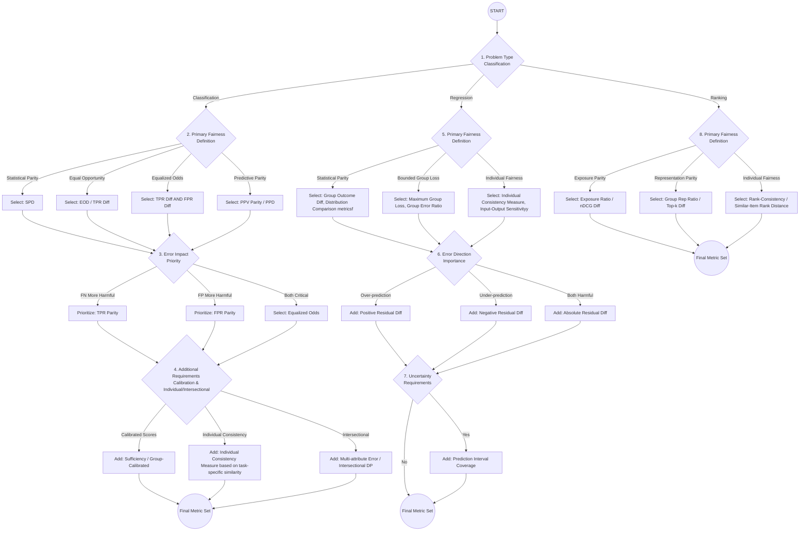

# Fairness Audit Playbook – Component 4
# Fairness Metrics Tool

- [Fairness Audit Playbook – Component 4](#fairness-audit-playbook--component-4)
- [Fairness Metrics Tool](#fairness-metrics-tool)
    - [**1 Metric Selection**](#1-metric-selection)
    - [**2 Statistical Validation**](#2-statistical-validation)
    - [**3 Visualization and Reporting System**](#3-visualization-and-reporting-system)
    - [**4 User Documentation Guide**](#4-user-documentation-guide)
      - [Phase 1: Metric Selection (The Decision Tree)](#phase-1-metric-selection-the-decision-tree)
        - [Step 1: Identify your Problem Type](#step-1-identify-your-problem-type)
        - [Step 2: Assign a Fairness Definition](#step-2-assign-a-fairness-definition)
        - [Step 3: Define Error Priorities](#step-3-define-error-priorities)
      - [Phase 2: Statistical Validation (The Bootstrap)](#phase-2-statistical-validation-the-bootstrap)
        - [Step 1: Execute the Bootstrap](#step-1-execute-the-bootstrap)
        - [Step 2: Handle Small Samples](#step-2-handle-small-samples)
      - [Phase 3: Visualization \& Interpretation](#phase-3-visualization--interpretation)
      - [Phase 4: Reporting and Action](#phase-4-reporting-and-action)

### **1 Metric Selection** 

This decision tree helps match fairness definitions to appropriate metrics:
Statistical Parity Difference (SPD)  
Equal Opportunity Difference (EOD)  
Predictive Parity Difference (PPD)  
False Negatives (FN)  
False Positives (FP)  
True Positive Rate (TPR)  
False Positive Rate (FPR)  
Positive Predictive Value (PPV)  
Demographic Parity (DP)  
Normalized Discounted Cumulative Gain Difference (nDCG Diff)  
Group Representation Ratio (Group Rep Ratio)  
Top-k Proportion Difference (Top-k Diff) 

### **2 Statistical Validation**

**Bootstrap Confidence Intervals for Group Fairness Metrics**

1. Resample with replacement from original dataset.
2. Calculate fairness metric on each resampled dataset.
3. Determine confidence intervals from the resulting distribution.
4. Report 95% confidence intervals for all metrics.

**Small Sample Handling**

1. For groups with fewer than 100 samples, use Bayesian approaches with weakly informative priors.
2. Report credible intervals rather than confidence intervals.
3. Explicitly note small sample sizes in visualization and reporting.

### **3 Visualization and Reporting System**

**Fairness Disparity Chart**

- Bar chart showing primary metrics across groups with confidence intervals.
- Color-coding indicating statistical significance.
- Reference lines for acceptable thresholds.

**Intersectional Heatmap**

- Heatmap showing metric values across all intersectional groups.
- Color gradient indicating magnitude of disparities.
- Cell size or opacity indicating sample size.

### **4 User Documentation Guide**
#### Phase 1: Metric Selection (The Decision Tree)
Before calculating numbers, you must select the metric that aligns with your specific use case and "History of Harm."
##### Step 1: Identify your Problem Type
Navigate the decision tree based on the model’s output:
- Classification: Does the model give a "Yes/No" or "Pass/Fail" result?
- Regression: Does the model predict a continuous number (e.g., salary, risk score)?
- Ranking: Does the model order items in a list (e.g., search results, job applicants)?
##### Step 2: Assign a Fairness Definition
Based on your HCAT findings and FDST, choose your primary lens:
- Statistical Parity: Use if the goal is equal representation, regardless of "qualifications" (often used to correct historical exclusion).
- Equal Opportunity: Use if the goal is to ensure that "qualified" individuals from all groups are treated equally.
- Predictive Parity: Use if the "meaning" of a positive result must be consistent (e.g., a "High Risk" score must mean the same thing for everyone).
##### Step 3: Define Error Priorities
- Decide which mistake is more damaging:
- False Negatives (FN): Missing a qualified person.
- False Positives (FP): Wrongly flagging an innocent person.
#### Phase 2: Statistical Validation (The Bootstrap)
Raw fairness scores can be misleading due to small sample sizes or data noise. You must validate the stability of your results.
##### Step 1: Execute the Bootstrap
- Resample: Take your original test data and create 1,000 "virtual" datasets by sampling with replacement.
- Calculate: Run your chosen fairness metric on all 1,000 datasets.
- Aggregate: Find the mean and the 95% Confidence Interval (the range where the middle 950 results fall).
##### Step 2: Handle Small Samples
If a protected group has N < 100:
- Label the result as "Low Confidence."
- Use a Bayesian Credible Interval instead of a standard Confidence Interval to account for the uncertainty.
#### Phase 3: Visualization & Interpretation
Visual tools translate mathematical parity into business risk.
1. Fairness Disparity Chart
Look for: Bars that fall outside the "Acceptable Threshold" (usually the 80% rule).
Check the Whiskers: If the error bars (Confidence Intervals) are very wide, your finding is inconclusive. If they are narrow and outside the threshold, the bias is statistically significant.
2. Intersectional Heatmap
Identify Overlaps: Look for "Deep Red" cells. These indicate groups at the intersection of demographics (e.g., "Young + Female") who are experiencing compounded disadvantage.
Check Opacity: If a cell is faded or greyed out, it means the sample size was too small to draw a definitive conclusion.
#### Phase 4: Reporting and Action
Every audit must conclude with a clear status for each metric:

Status	Meaning   
✅ PASS	Metric is within threshold; CI is stable.	Document and monitor in production.  
⚠️ INCONCLUSIVE	Metric is poor, but N is too small.	Collect more data on the specific subgroup.  
🚨 FAIL	Metric is poor; result is significant.	Pause deployment; initiate "Mitigation" phase.  

