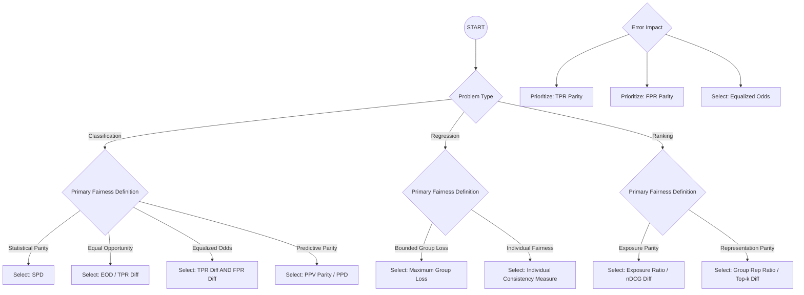

# Fairness Audit Playbook – Component 4
# Fairness Metrics Tool

- [Fairness Audit Playbook – Component 4](#fairness-audit-playbook--component-4)
- [Fairness Metrics Tool](#fairness-metrics-tool)
    - [1 Metric Selection](#1-metric-selection)
    - [2 Statistical Validation](#2-statistical-validation)
    - [3 Visualization and Reporting System](#3-visualization-and-reporting-system)
    - [4 User Documentation Guide](#4-user-documentation-guide)

### 1 Metric Selection

This decision tree helps match fairness definitions to appropriate metrics: SPD, EOD, PPD, TPR, FPR, PPV, Demographic Parity, nDCG Diff, Group Rep Ratio, Top-k Diff.

### 2 Statistical Validation

**Bootstrap Confidence Intervals for Group Fairness Metrics**

1. Resample with replacement from the original dataset.
2. Calculate the fairness metric on each resampled dataset.
3. Determine confidence intervals from the resulting distribution.
4. Report 95% confidence intervals for all metrics.

**Small Sample Handling**

1. For groups with fewer than 100 samples, use Bayesian approaches with weakly informative priors.
2. Report credible intervals rather than confidence intervals.
3. Explicitly note small sample sizes in visualization and reporting.

### 3 Visualization and Reporting System

**Fairness Disparity Chart**
- Bar chart showing primary metrics across groups with confidence intervals.
- Color-coding indicating statistical significance.
- Reference lines for acceptable thresholds.

**Intersectional Heatmap**
- Heatmap showing metric values across intersectional groups.
- Color gradient indicating magnitude of disparities.
- Cell opacity indicating sample size.

### 4 User Documentation Guide

Phase 1: Metric Selection
- Identify problem type (classification, regression, ranking).
- Assign a fairness definition based on HCAT and FDST.
- Define error priorities (FN vs FP).

Phase 2: Statistical Validation
- Execute bootstrap (e.g., 1,000 resamples) to estimate confidence intervals.
- For small groups, use Bayesian credible intervals and label results as low confidence when N < 100.

Phase 3: Visualization & Interpretation
- Use disparity charts and intersectional heatmaps to translate mathematical parity into business risk.
- If error bars are wide, mark findings as inconclusive.

Phase 4: Reporting and Action
Status meanings:
- ✅ PASS: Metric within threshold and CI stable. Document and monitor in production.
- ⚠️ INCONCLUSIVE: Metric poor, but N too small. Collect more data.
- 🚨 FAIL: Metric poor and significant. Pause deployment and initiate mitigation.
